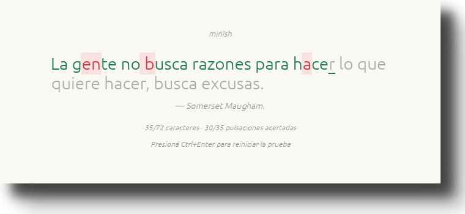

# minish

[](https://github.com/Gentleman-Programming/gentle-ai)

<p align="center">
  
</p>

Entrenador de mecanografía minimalista: una frase real por vez, nada más.

Practicás con citas reales en español —con sus acentos, comas, mayúsculas y
signos de apertura— en una ventana chica que se queda arriba de todo. Al
terminar te muestra palabras por minuto, precisión y ritmo.



## Cómo correrlo

Necesitás Rust 1.85 o superior (el proyecto usa la edición 2024). La única
dependencia es `eframe`, que baja `cargo` solo.

```sh
cargo run --release
```

El primer build compila `eframe` y compañía, así que tarda unos minutos. Los
siguientes son instantáneos.

## Controles

| Tecla | Qué hace |
| --- | --- |
| Cualquier tecla | Escribe el carácter siguiente |
| `Backspace` | Borra el último carácter |
| `Ctrl+Enter` | Reinicia con una frase nueva |

El cronómetro arranca con la **primera tecla**, no al abrir la ventana: pensar
la frase no cuenta.

## Qué mide

- **WPM** — caracteres correctos dividido 5, por minuto. La convención de "una
  palabra son 5 caracteres" es la que usan casi todos los tests de tipeo.
- **Precisión** — pulsaciones acertadas sobre el total. Un error que corregís
  con `Backspace` **sigue contando**: es lo que hace un test de tipeo real.
- **Ritmo** — milisegundos promedio por pulsación.

La sesión termina al llegar al último carácter de la frase, aciertes o no. Por
eso la última letra no se puede corregir, igual que en monkeytype.

## Las frases

Están en `resources/frases.txt`, una por línea, con el autor separado por un
**tabulador**:

```text
Si crees que C++ es difícil, intenta aprender inglés.<TAB>Bjarne Stroustrup
```

El archivo se embebe en el binario con `include_str!`, así que la app no depende
del directorio desde donde la ejecutes — pero **sin el archivo no compila**. Si
lo editás, volvé a compilar.

Dos detalles del formato:

- El autor es **opcional**: una línea sin tabulador es una frase sin autor (el
  archivo tiene un par así).
- El autor es **informativo**: se muestra en gris debajo de la frase y no se
  tipea. La práctica es solo el texto.

Entran las frases de hasta 130 caracteres. Con la ventana de 720×300 y la fuente
de 28 px entran tres líneas, y ese presupuesto es el que fija el límite en
`phrases::MAX_CHARS`; las más largas se descartan al cargar (hoy son 63 de 630).
Si agregás una frase que no entra en la ventana, el test de layout te lo dice.

## Ventana flotante

La ventana es de tamaño fijo (720×300), queda siempre arriba y pide la esquina
superior derecha. En niri se abre flotante sola; fijarle la posición exacta
requiere una regla del compositor, porque Wayland no deja que un cliente se
ubique a sí mismo. Está explicado en [`doc/niri.md`](doc/niri.md).

## Estructura

| Módulo | Responsabilidad |
| --- | --- |
| `src/main.rs` | Arranque y opciones de la ventana |
| `src/app.rs` | Capa de egui: dibuja y traduce eventos a pulsaciones |
| `src/session.rs` | Qué se tipeó y en qué estado está la prueba |
| `src/stats.rs` | Fórmulas de WPM, precisión y ritmo (puro, sin egui) |
| `src/phrases.rs` | Frases embebidas, parseo y elección al azar |
| `src/theme.rs` | Paleta y tipografía |

La regla que ordena el diseño: `stats` y `session` no saben que existe una
ventana. Por eso las métricas se testean sin abrir una, y los tests pueden
simular sesenta segundos en cero tiempo real.

## Desarrollo

```sh
cargo test                              # 28 tests
cargo clippy --all-targets -- -D warnings
cargo fmt --check
```

Los tests de layout corren un frame real de egui sin GPU (`ctx.run_pass`) y
miden **todas** las frases del archivo: una frase nueva que no entre rompe los
tests en vez de romper la ventana.
